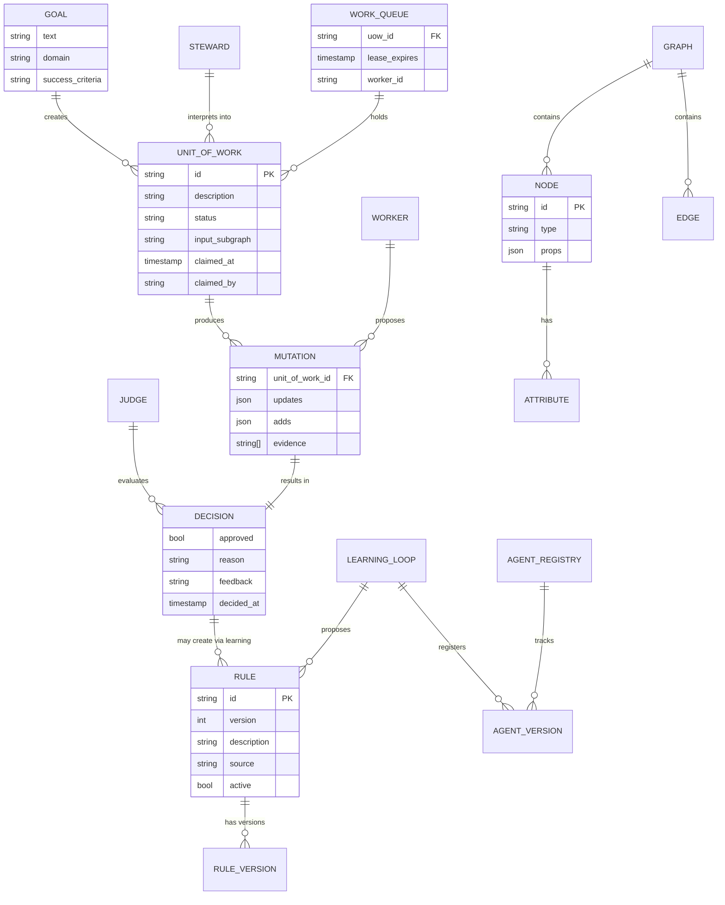
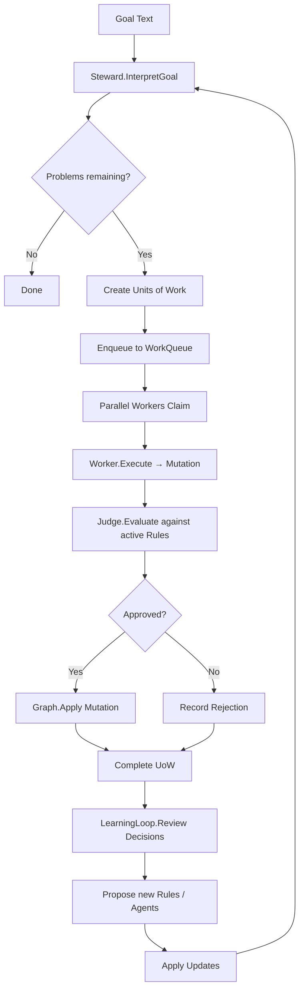
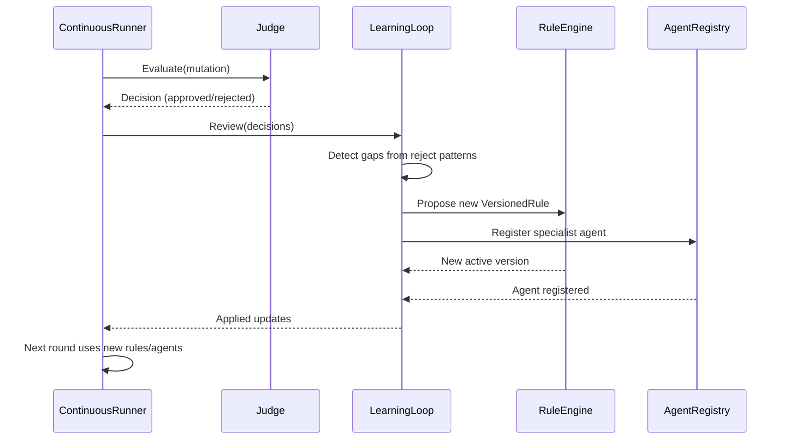
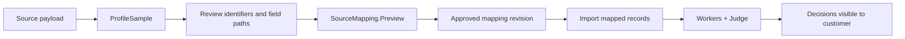
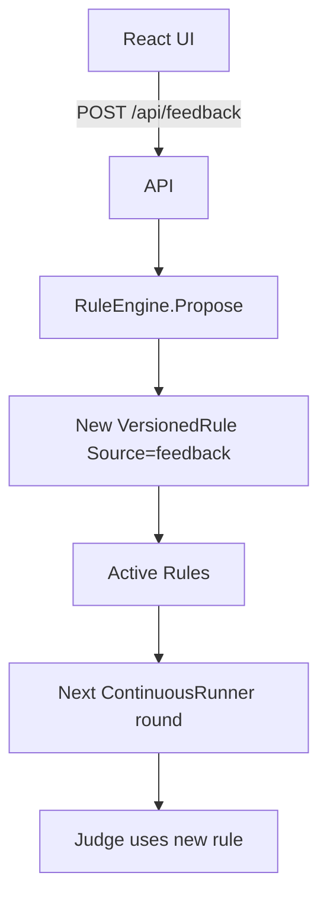
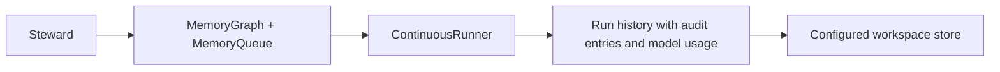

# Entity-Relationship and Architecture Diagrams

This document contains detailed diagrams of the Agent Factory control plane and data model.

## 1. Core Data Model (ER Diagram)

## 2. Continuous Execution Flow

## 3. Self-Learning Loop

## 4. Source Mapping to Entity

## 5. Customer Feedback Path

## 6. Persistence Modes

## Notes

- All mutations are proposed and only applied after Judge approval.
- Rules are immutable and versioned; only one version is active.
- LearningLoop closes the loop so rejects improve the next round automatically.
- Domain packs supply detectors, attribute sets, and default rules without changing the core.
- The same model works for catalog, pricing, inventory, merchandising, or any Entity-based problem.
