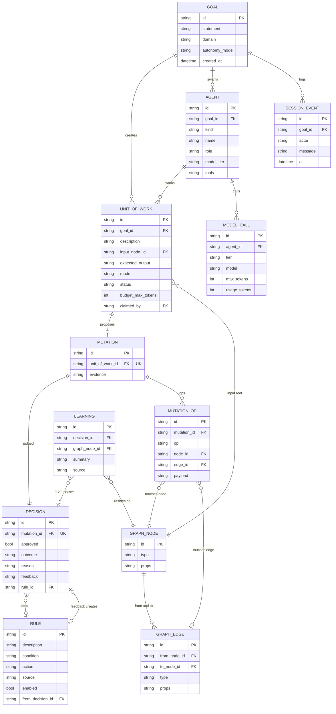
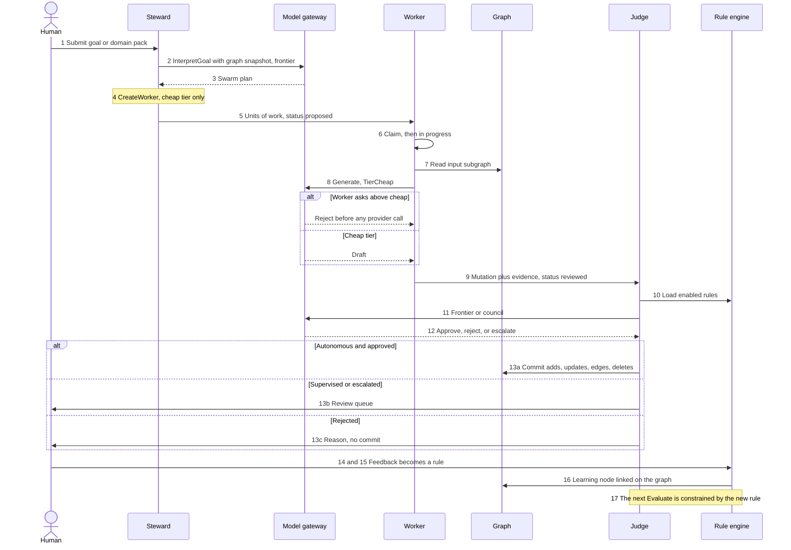

# Diagrams

Editable board (two pages: **Entity relationship**, **Request flow**):

https://www.figma.com/board/KuMPrXQ5TOGtIQivDJWxOv

The diagrams below match that board. They describe the logical model behind `internal/graph`, `internal/unitofwork`, `internal/agents`, and `internal/models`.

## Logical model

Crow's foot. `PK` primary key, `FK` foreign key, `UK` unique.

Graph nodes are domain-agnostic. A retail catalog, a price, a rule, and a learning are all nodes (or edges) of one graph. Schema for a goal is loaded or evolved by the Steward.

### Enums

| Field | Values |
| --- | --- |
| `agent.kind` | `steward`, `judge`, `worker`, `memory`, `rule` |
| `agent.model_tier` | `cheap`, `frontier`, `council` |
| `unit_of_work.mode` | `deterministic`, `non_deterministic` |
| `unit_of_work.status` | `proposed`, `claimed`, `in_progress`, `reviewed`, `committed`, `rejected` |
| `decision.outcome` | `approved`, `rejected`, `escalated` |
| `rule.action` | `approve`, `reject`, `escalate` |
| `rule.source` | `human`, `feedback`, `agent` |
| `mutation_op.op` | `add`, `update`, `delete`, `edge` |
| `goal.autonomy_mode` | `supervised`, `autonomous` |

`escalated` is a decision outcome. The unit stays in review until a person commits or rejects it. It is not a sixth stored status on `unit_of_work` unless a later migration adds it.

### Invariants

- Workers may only call `TierCheap`. The model gateway rejects a higher tier before any provider call.
- Steward and Judge may use `frontier` or `council`.
- A mutation is applied to the graph only after the Judge approves it, or a person overrides.
- Feedback on a decision becomes a rule (`source = feedback`). The next `Evaluate` is constrained by that rule.
- Learnings are graph-resident: a `learning` row points at a `graph_node`.

## Request flow

One goal, left to right across lanes: Human, Steward, Worker, Model gateway, Judge, Graph, Rule engine.

```mermaid
flowchart LR
  s1["1 Submit goal or domain pack"] --> s2["2 InterpretGoal"]
  s2 --> s3["3 Frontier swarm design"]
  s3 --> s4["4 Create workers, cheap only"]
  s4 --> s5["5 Units of work proposed"]
  s5 --> s6["6 Claim, then in progress"]
  s6 --> s7["7 Read input subgraph"]
  s7 --> s8["8 TierCheap generate, or reject"]
  s8 --> s9["9 Propose mutation and evidence"]
  s9 --> s10["10 Evaluate rules and evidence"]
  s10 --> s11["11 Frontier or council"]
  s11 --> s12{"12 Decision"}
  s12 -->|"autonomous + approved"| s13a["13a Commit to graph"]
  s12 -->|"supervised or escalated"| s13b["13b Human queue"]
  s12 -->|rejected| s13c["13c No commit"]
  s13b --> s14["14 Feedback"]
  s13c --> s14
  s14 --> s15["15 Rule, source feedback"]
  s13a --> s16["16 Learning node"]
  s15 --> s16
  s16 --> s17["17 Next Evaluate constrained"]
```

Unit-of-work status moves `proposed` to `claimed` to `in_progress` to `reviewed`, then `committed` or `rejected`. An escalated decision waits on the human queue before either commit.
